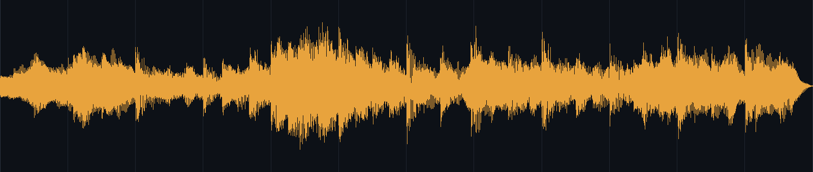
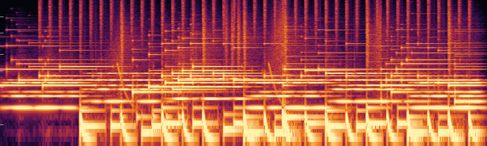

# video-score-composer

[](https://github.com/SJLH2004/video-score-composer/actions/workflows/ci.yml)


**Compose an original score that is locked to your footage — synthesised from oscillators, no samples, no library, no licensing risk.**

Most "add music" tools help you *pick* a track. This one reads the cut: it finds
where the picture actually moves, builds a tempo grid around those moments, then
synthesises a score from scratch so every landing, cut and reveal gets a musical
gesture on the exact frame it happens.



*Example score included in the repo — a 12 s flat-illustration promo, 120 BPM,
6 bars, rendered by `scripts/score_engine.py`. Listen: [`docs/example-score.mp3`](docs/example-score.mp3).*

---

## The problem

Background music for a short promo is usually one of two things:

1. **A stock loop**, which never actually lines up with your cuts, carries
   licensing paperwork, and sounds like every other video in your feed.
2. **Nothing**, because the edit is 12 seconds long and licensing a real cue is
   not worth it.

Both are solved by making the music yourself — but writing it by ear against a
timeline is slow, and most "AI music" tools still generate from a text prompt,
ignoring the picture entirely.

This tool does the part that is actually mechanical: **measure the picture, then
place notes on the frames that matter.**

## How it works

```text
video ──► rhythm_scan.py ──► rhythm.json ──► you write an arrangement ──► score_engine.py ──► score.wav
              │                                     (JSON)                                      │
         motion / brightness                                                              original audio
         tempo shortlist                                                                  (numpy only)
```

### 1. Scan the rhythm

```bash
python scripts/rhythm_scan.py promo.mov --out rhythm.json
```

Every frame is extracted at 320 px and turned into:

| Output | What it tells you |
|---|---|
| `action_peaks` | frames where the picture changes fastest — hit these |
| `scene_boundaries` | `t` = where a transition **starts**, `end` = where it settles |
| `static_windows` | stretches where nothing moves — leave the score open here |
| `suggested_bpm` | tempo shortlist, filtered to tempos where the whole piece is a whole number of bars |

The shortlist is **input, not the answer**. Pick the tempo by picture tempo:
corporate / flat illustration 100–125, fast-cut 128–150, lyrical 70–95. A 12 s
film at 120 BPM is exactly 6 bars — which is usually why a tempo "feels right".

### 2. Map picture gestures to musical gestures

This table is the whole idea in one screen:

| Picture gesture | Musical gesture |
|---|---|
| Element fades / rises in | soft bell or kalimba on the frame it starts |
| Object drops and settles | struck note (marimba) at the landing frame |
| Several objects land in sequence | ascending scale, one note per landing |
| Hard cut / scene change | noise riser into the cut, impact on settle |
| Data or text popping in | short bell, panned toward where it appears |
| Growth curve drawing | ascending arpeggio spanning the draw |
| Final logo hold | resolved chord decaying into the last frame |

Place cues **20–40 ms before** a percussive visual landing. The ear forgives
early; it never forgives late.

### 3. Write the arrangement

Copy [`assets/example_arrangement.json`](assets/example_arrangement.json) and
edit it. One JSON file describes the entire score — absolute times in seconds,
chords, one-shot events and repeats:

```json
{
  "duration": 12.0,
  "style": "wood",
  "seed": 20261020,
  "chords": [ { "t": 0.0, "dur": 2.2, "name": "C", "g": 0.85 } ],
  "events": [ { "inst": "marimba", "t": 3.28, "pitch": "G4", "pan": -0.5 } ]
}
```

Every field and instrument is documented in
[`references/arrangement_schema.md`](references/arrangement_schema.md).

### 4. Render and check

```bash
python scripts/score_engine.py arrangement.json score.wav
```

```text
peak 0.850  rms -16.8 dBFS  rolloff85 1046 Hz
wrote score.wav (12.00s)
```

Those three numbers are the objective QA. `rolloff85` is the brightness metric
that matters — 85 % of the energy below that frequency. Target **1.0–2.0 kHz**
for wood/percussion scores; below 900 Hz is dull, above 3 kHz is usually noise.

Then mux:

```bash
ffmpeg -y -i promo.mov -i score.wav -map 0:v:0 -map 1:a:0 \
  -c:v libx264 -preset slow -crf 15 -tune animation -pix_fmt yuv420p \
  -c:a aac -b:a 192k -shortest -movflags +faststart out.mp4
```

Always force `-pix_fmt yuv420p` — leave NVENC on `gbrp` and some players render
the chroma planes wrong (picture turns pink-green on phones).

## Quickstart

```bash
pip install -r requirements.txt          # numpy + pillow
ffmpeg -version                          # must be on PATH for the scan step

python scripts/rhythm_scan.py my_video.mov --out rhythm.json
python scripts/score_engine.py assets/example_arrangement.json out.wav
python selftest.py                       # verify your install
```

`rhythm_scan.py` needs `ffmpeg` / `ffprobe`. `score_engine.py` needs only
`numpy` — it does not touch a single audio file on disk.

## Why it doesn't sound like beeps

Pitched percussion is not a sine wave. Each instrument stacks partials at
physical ratios, and higher partials decay faster than the fundamental — that is
what makes struck wood sound like struck wood:

| Instrument | Partials (× fundamental) |
|---|---|
| `marimba` | 1, 3.99, 6.30, 9.10 |
| `kalimba` | 1, 2.0, 5.4, 8.1 |
| `bell` | 1, 2.76, 5.40, 8.93 |
| `piano` | 1…9 integer harmonics at 1/k^1.3, plus a +0.15 % detuned layer |

Thirteen instruments are available: `marimba`, `kalimba`, `piano`, `bell`,
`pad`, `bass`, `kick`, `clap`, `shaker`, `riser`, `sweep`. The reverb is a
convolution IR built from exponentially decaying noise, lowpassed at 5.2 kHz so
the tail is soft rather than bright.



*The example score, 40 Hz–20 kHz. Horizontal lines are the pad's harmonic
partials, the regular vertical stripes are the shaker pulse, and the wide bands
are kicks and claps. Nothing is above 20 kHz because nothing needs to be.*

The full mixing guide — the three failure modes (muddy / harsh / pumping), how to
fix each *in order*, stereo placement, and the `wood` vs `piano` presets — is in
[`references/sound_design.md`](references/sound_design.md).

## What this is not

- **Not a stock library.** There are no audio files in this repo. Every sample is
  computed at render time from oscillators and filtered noise.
- **Not a stem separator or a mix cleaner.** It does not replace dialogue audio
  or fix sound design.
- **Not a one-click AI generator.** It is deliberately a tool with a JSON
  arrangement in the middle, so the musical decisions stay yours.

## Use it as an agent skill

[`SKILL.md`](SKILL.md) is a ready-to-paste skill definition for agent runtimes
(Claude Skills / WorkBuddy / any SKILL.md-compatible loader). Drop the folder in
your skills directory and the agent will follow the same scan → arrange → render
pipeline when asked to 配乐 / add BGM / score a video.

## Repo layout

```text
scripts/rhythm_scan.py          video → rhythm map (needs ffmpeg)
scripts/score_engine.py         arrangement JSON → stereo WAV (needs numpy only)
assets/example_arrangement.json full 12 s score, use as the starting template
references/arrangement_schema.md  every field, instrument and timing rule
references/sound_design.md      timbre, spectrum self-check, mastering
references/parsing_notes.md     ffmpeg and After Effects gotchas
docs/                           example render + waveform
selftest.py                     end-to-end check, no network, no fixtures
SKILL.md                        agent skill definition
```

## Requirements

- Python 3.9+
- `numpy` (render), `pillow` (scan)
- `ffmpeg` + `ffprobe` on `PATH` (scan and mux only)

CI runs `selftest.py` on Linux, macOS and Windows against Python 3.9 and 3.12.
The scan test generates its own video with `ffmpeg -f lavfi` and skips cleanly
when ffmpeg is not installed.

## License

MIT — see [LICENSE](LICENSE). The output audio is yours: it is generated from
oscillators, so there is no sample clearance to worry about.
